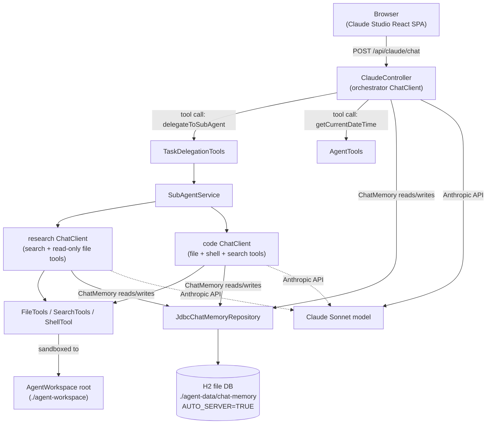
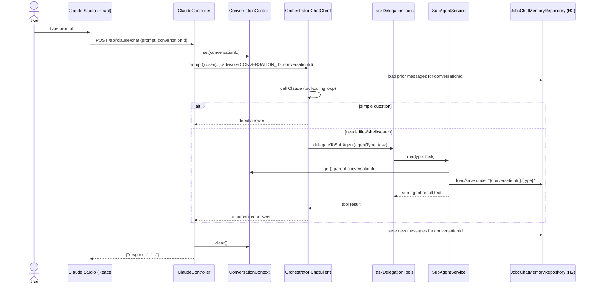

# Architecture

As-built technical reference for `spring-ai-agents`. For a narrative walkthrough of
the underlying concepts, see [guide.md](guide.md); for the UI, see [ui-guide.md](ui-guide.md).

## System overview

A single Spring Boot process exposes one REST endpoint backed by an orchestrator
agent (Claude, via Spring AI), which can answer directly or delegate work to one of
two isolated-context sub-agents. All agents share one persistent chat-memory store
and one sandboxed filesystem.

## Components

| Component | File | Responsibility |
|---|---|---|
| Orchestrator | [ClaudeController.java](src/main/java/com/example/springaiagents/ClaudeController.java) | HTTP entry point (`POST /api/claude/chat`). Owns the top-level `ChatClient`, memory advisor, and system prompt that tells the model when to answer directly vs. delegate. Sets `conversationId` on `ConversationContext` for the duration of the request. |
| Demo tool | [AgentTools.java](src/main/java/com/example/springaiagents/AgentTools.java) | `getCurrentDateTime` — trivial `@Tool` available only to the orchestrator. |
| Task router / delegation tool | [agents/TaskDelegationTools.java](src/main/java/com/example/springaiagents/agents/TaskDelegationTools.java) | The orchestrator's only other tool: `delegateToSubAgent(agentType, task)`. The model itself decides whether/when to call it — there is no separate rule-based router. |
| Sub-agent runtime | [agents/SubAgentService.java](src/main/java/com/example/springaiagents/agents/SubAgentService.java) | Builds two isolated `ChatClient`s (`research`, `code`), each with its own system prompt and tool subset, sharing one `ChatMemory` instance. |
| Sub-agent type | [agents/SubAgentType.java](src/main/java/com/example/springaiagents/agents/SubAgentType.java) | `RESEARCH` / `CODE` enum with case-insensitive parsing from the tool argument. |
| Conversation propagation | [agents/ConversationContext.java](src/main/java/com/example/springaiagents/agents/ConversationContext.java) | Thread-local carrying the parent `conversationId` from the controller into whichever sub-agent the model delegates to within the same request thread. |
| Sandbox | [workspace/AgentWorkspace.java](src/main/java/com/example/springaiagents/workspace/AgentWorkspace.java) | Resolves all tool paths under one root directory; rejects any path that would escape it (`SecurityException`). |
| File tools | [tools/FileTools.java](src/main/java/com/example/springaiagents/tools/FileTools.java) | `readFile` / `writeFile` / `listFiles`, size-capped, sandboxed. |
| Search tools | [tools/SearchTools.java](src/main/java/com/example/springaiagents/tools/SearchTools.java) | `grep` (regex) / `glob`, result-capped, sandboxed. |
| Shell tool | [tools/ShellTool.java](src/main/java/com/example/springaiagents/tools/ShellTool.java) | `runCommand`, allow-listed commands only, no shell interpretation (`ProcessBuilder` arg list), timeout + output cap. |
| Frontend | [frontend/](frontend/) | React (Vite) SPA ("Claude Studio"), built by `frontend-maven-plugin` into `src/main/resources/static`; talks only to `/api/claude/chat`. |

## Request flow

## Persistence

- **Store**: embedded H2, file-backed at `agent-data/chat-memory.mv.db`, accessed through Spring AI's `JdbcChatMemoryRepository` (single table `SPRING_AI_CHAT_MEMORY`). Schema auto-creates on startup (`spring.ai.chat.memory.repository.jdbc.initialize-schema=always`) using the Postgres-dialect DDL script, since H2 has no dedicated one and the repository's dialect resolver already treats unrecognized drivers as Postgres-compatible.
- **Sharing model**: the orchestrator and both sub-agents inject the *same* `ChatMemoryRepository` bean, so all conversation state lives in one table. Rows are namespaced by `conversation_id`: the orchestrator uses the caller-supplied id as-is; each sub-agent uses `"{conversationId}:research"` or `"{conversationId}:code"`.
- **Multi-process access**: the JDBC URL includes `AUTO_SERVER=TRUE`, so a second process can open the same DB file concurrently without lock errors (the first process transparently becomes a TCP server for the rest). For a fully standalone database instead of file-based embedded mode (e.g. shared Postgres/MySQL, or a dedicated H2 TCP server), override `SPRING_DATASOURCE_URL` / `_USERNAME` / `_PASSWORD` / `_DRIVER` — no code changes required.
- **Config**: [application.yml](src/main/resources/application.yml).

## Security / sandboxing model

All filesystem and process access available to the LLM is confined to a single
directory tree and a small, explicit allow-list:

- `AgentWorkspace` resolves every relative path against one root (`agents.workspace.root`, default `./agent-workspace`) and throws `SecurityException` on any path that normalizes outside it (blocks `../` traversal).
- `ShellTool` only runs commands in `{ls, pwd, cat, wc, grep, find, echo, date}` — all read-only — via `ProcessBuilder` with an argument list (never `/bin/sh -c`), so there is no shell metacharacter injection surface. Commands run with a working directory pinned to the sandbox root, a 10s timeout, and a 4000-char output cap.
- `FileTools`/`SearchTools` cap read size and result counts to bound tool-output size.
- The chat-memory database directory (`agent-data/`) is intentionally kept outside the sandboxed workspace so the LLM's own file/shell/search tools can't read or tamper with conversation history.

## Configuration surface

| Property | Default | Purpose |
|---|---|---|
| `ANTHROPIC_API_KEY` | (required) | Anthropic API credential |
| `ANTHROPIC_MODEL` | `claude-sonnet-5-5` | Model id |
| `AGENTS_WORKSPACE_ROOT` | `./agent-workspace` | Sandbox root for file/search/shell tools |
| `SPRING_DATASOURCE_URL` | `jdbc:h2:file:./agent-data/chat-memory;AUTO_SERVER=TRUE` | Chat-memory datasource |
| `SPRING_DATASOURCE_USERNAME` / `_PASSWORD` / `_DRIVER` | `sa` / (empty) / `org.h2.Driver` | Chat-memory datasource credentials/driver |

## Known gaps / next steps

- No Agent Skills (Markdown + YAML front-matter) layer yet.
- No web-search tool; `research` sub-agent is limited to the local sandboxed workspace.
- Only two sub-agent types (`research`, `code`); no dedicated "data" agent.
- Routing is entirely LLM-driven (via the orchestrator's system prompt + tool description) — there is no deterministic/rule-based fallback router.
