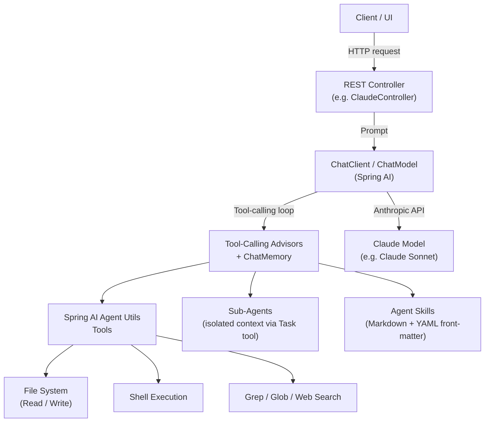
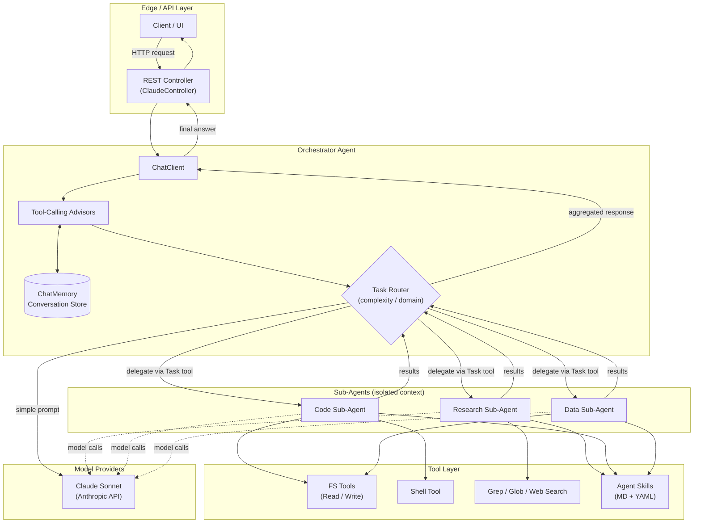
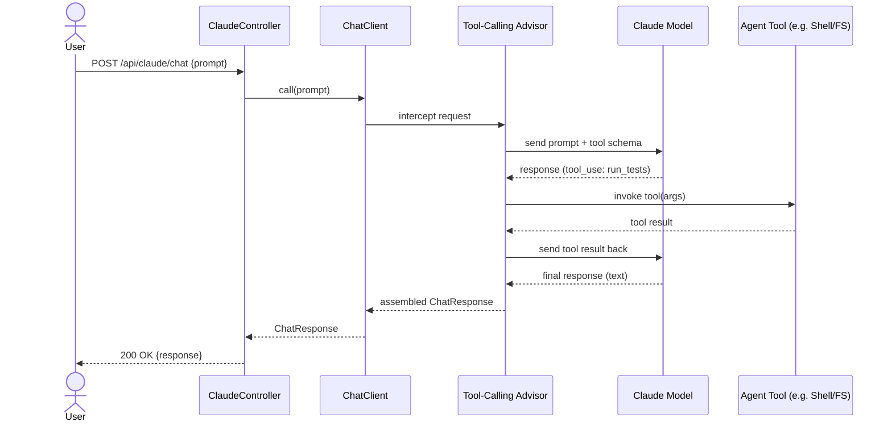
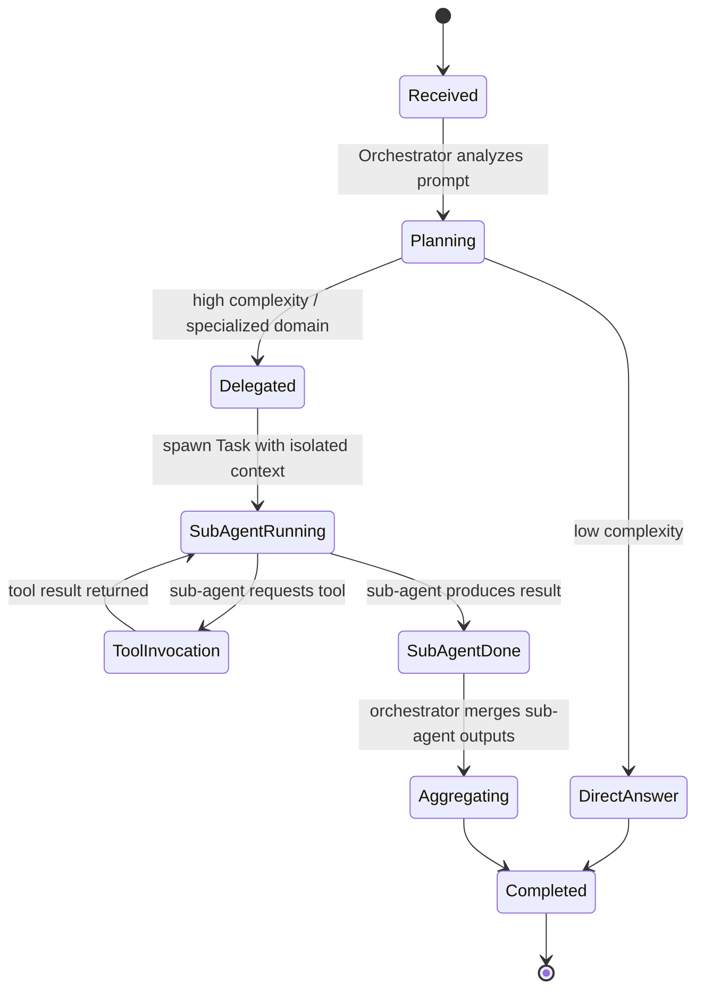

# Building AI Agents with Claude in Spring AI

Building AI agents with Claude in Spring AI involves leveraging native Anthropic
integrations, the `ChatClient` API, and the specialized **Spring AI Agent Utils**
library, which brings Claude Code-inspired tools and agent patterns to Java.

## Core Concepts & Architecture

### Native Claude Integration

Connects via Spring AI's Anthropic support using models like Claude Sonnet
directly on the JVM, without needing a Python sidecar.

### Spring AI Agent Utils

A community/incubating toolkit that reverse-engineers and implements Claude
Code-inspired capabilities as native Spring AI tools.

- **Tool Categories**: File system operations (Read, Write), shell execution,
  grep/glob search, and web search integration.
- **Sub-Agent Orchestration**: Allows main agents to delegate complex,
  multi-step subtasks to specialized subagents using isolated context windows
  via a portable `Task` tool.
- **Agent Skills**: Reusable knowledge modules written in Markdown with YAML
  front-matter that guide agent behaviors on demand.

## Advanced Multi-Agent Architecture

A production-grade agent goes beyond a single request/response call. The
diagrams below illustrate the moving parts of a multi-agent, tool-calling
system built on Spring AI + Claude.

### Orchestrator + Sub-Agents + Shared Services

### Tool-Calling Execution Loop (Sequence)

### Sub-Agent Delegation State Machine

## Key Implementation Steps

1. **Add Dependencies**: Include Spring AI dependencies for Anthropic and
   configure `spring.ai.anthropic.api-key` in `application.properties` (or
   `application.yml`).
2. **Define Tools**: Use `@ToolDefinition` or the utility toolsets provided by
   Spring AI Agent Utils to expose file system or shell capabilities.
3. **Configure ChatClient & Advisors**: Set up Spring AI 2.0's tool-calling
   advisors to manage execution loops and handle conversational context with
   `ChatMemory`.

## Applying This to `spring-ai-agents`

This project now implements the orchestrator + sub-agent + tool layers from
the architecture above:

- [ClaudeController.java](src/main/java/com/example/springaiagents/ClaudeController.java)
  is the **orchestrator**: it exposes `POST /api/claude/chat`, builds a
  `ChatClient` around `AnthropicChatModel` wired with a
  `MessageChatMemoryAdvisor` (in-memory `MessageWindowChatMemory`, keyed by an
  optional `conversationId`), and registers `AgentTools` plus
  `TaskDelegationTools`. Its system prompt tells the model to answer simple
  questions directly and delegate anything needing files/shell/search — the
  model itself acts as the **task router** by choosing whether to call the
  delegation tool, matching the "Planning → DirectAnswer / Delegated" state
  machine above.
- [agents/TaskDelegationTools.java](src/main/java/com/example/springaiagents/agents/TaskDelegationTools.java)
  is the orchestrator-facing `Task` tool (`delegateToSubAgent(agentType, task)`)
  that hands a task off to an isolated sub-agent and returns its final result.
- [agents/SubAgentService.java](src/main/java/com/example/springaiagents/agents/SubAgentService.java)
  builds two isolated-context **sub-agents**, each its own `ChatClient` with
  its own system prompt and restricted toolset: a `research` agent (search +
  read-only file access) and a `code` agent (file read/write + shell + search).
- [tools/FileTools.java](src/main/java/com/example/springaiagents/tools/FileTools.java),
  [tools/SearchTools.java](src/main/java/com/example/springaiagents/tools/SearchTools.java), and
  [tools/ShellTool.java](src/main/java/com/example/springaiagents/tools/ShellTool.java)
  are the **Tool Layer**: file read/write/list, grep/glob search, and an
  allow-listed, shell-free (`ProcessBuilder`, no `/bin/sh -c`) command runner.
  All three are sandboxed through
  [workspace/AgentWorkspace.java](src/main/java/com/example/springaiagents/workspace/AgentWorkspace.java),
  which resolves every path under a single configurable root
  (`agents.workspace.root`, default `./agent-workspace`) and rejects any path
  that would escape it.
- [AgentTools.java](src/main/java/com/example/springaiagents/AgentTools.java)
  still defines the demo `@Tool`-annotated method available directly on the
  orchestrator.
- [frontend/](frontend/) is a React (Vite) single-page app — "Claude Studio" —
  that talks to `/api/claude/chat`, persists a `conversationId` per browser
  session, and renders the running conversation. It's built by
  `frontend-maven-plugin` into `src/main/resources/static` as part of the
  Maven build, so `mvn spring-boot:run` serves it directly; `npm run dev` in
  `frontend/` gives a hot-reload dev loop against the same backend.
- Agent Skills (Markdown + YAML front-matter) are still not wired up — that
  remains a natural next step, along with widening the sub-agent roster
  (e.g. a dedicated "data" agent) or adding a web-search tool.

