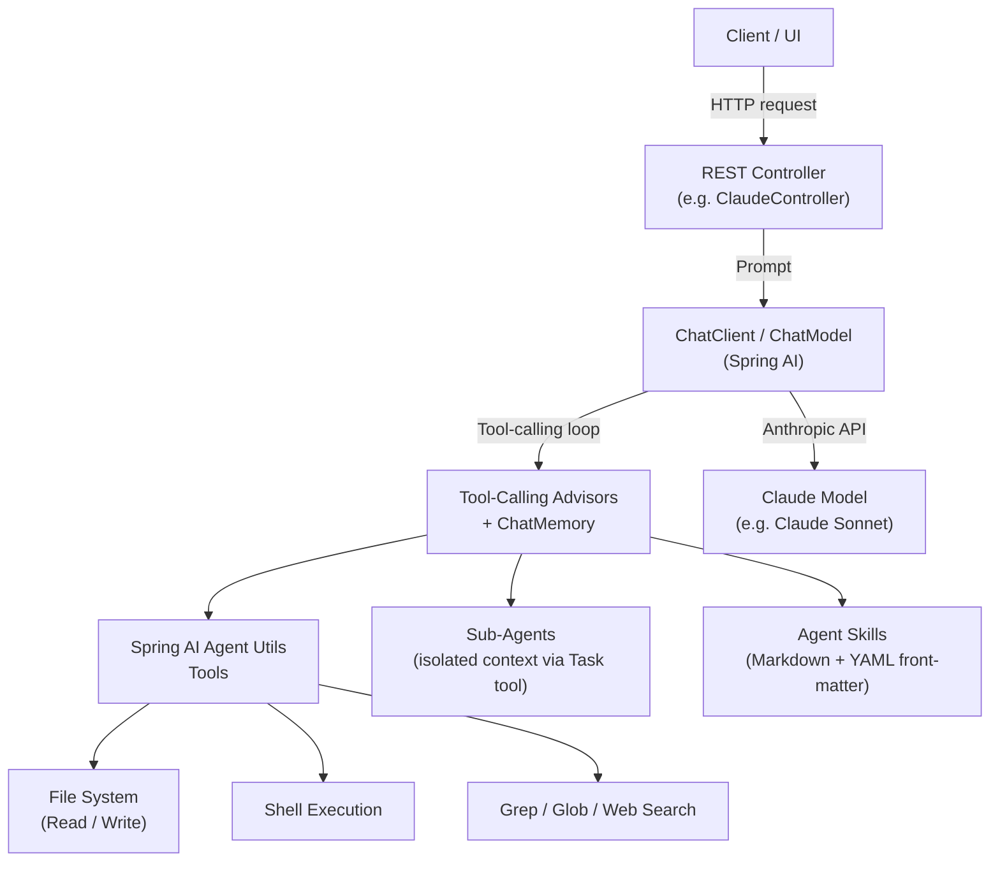
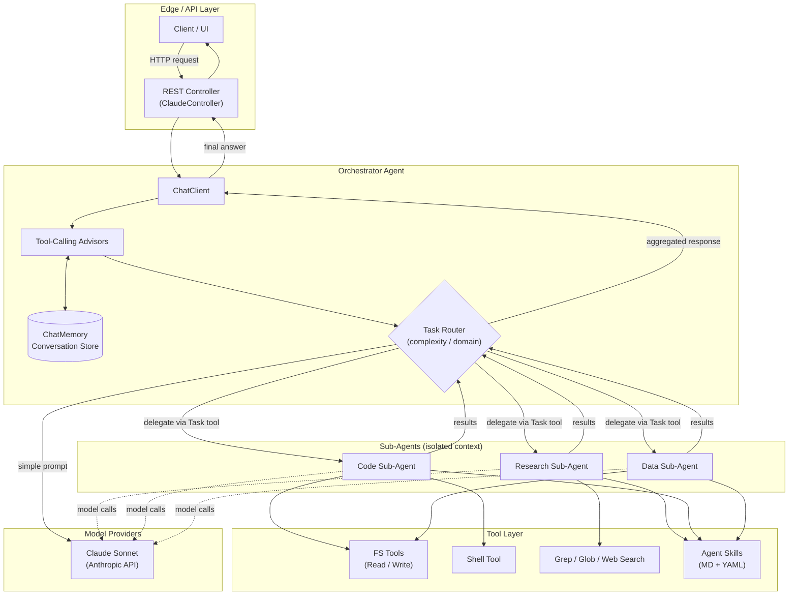
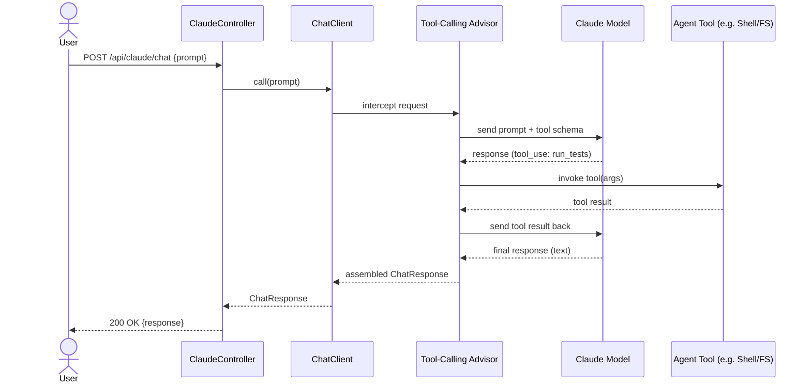
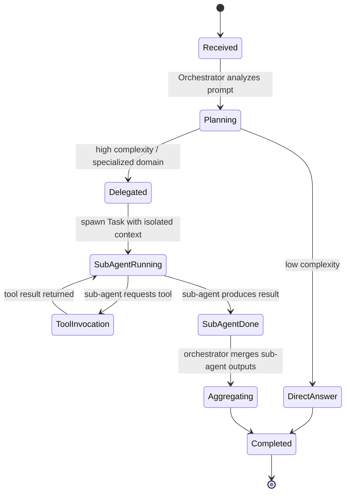

# Building AI Agents with Claude in Spring AI

Building AI agents with Claude in Spring AI involves leveraging native Anthropic
integrations, the `ChatClient` API, and the specialized **Spring AI Agent Utils**
library, which brings Claude Code-inspired tools and agent patterns to Java.

## Quick Start: Run and Use It

### Prerequisites

- Java 25 and Maven 3.9+ (Node is downloaded automatically by the Maven build).
- An Anthropic API key.

### 1. Configure your key

Put your key in a `.env` file at the project root (git-ignored):

```bash
ANTHROPIC_API_KEY=your-key
```

Spring Boot doesn't read `.env` by itself, so load it into your shell before
starting the backend:

```bash
set -a; . ./.env; set +a
```

**Notes on `.env` (for later review)**

- Format: plain `NAME=value` lines, no quotes and no spaces around `=`.
- Only `ANTHROPIC_API_KEY` is used today (the project only includes the
  Anthropic model). Other entries such as `OPENAI_API_KEY` or `OLLAMA_API_KEY`
  are ignored until those providers are added.
- `.env` and `.env.*` are git-ignored (`.env.example` is not). Never commit real
  keys; restrict the file to your user with `chmod 600 .env`.
- `.env` is separate from the gateway admin UI's key list. `.env` is your own
  file that you load manually. The UI's key list is optional and only helps you
  switch between several Anthropic keys by writing
  `gateway/gateway-data/active-key.env`.
- To switch keys via the UI, load `gateway/gateway-data/active-key.env` instead of
  `.env` before starting the backend. If you load both, whichever you source
  last wins.
- The backend reads its key once at startup, so any key change requires a
  backend restart.

### 2. Start the backend (port 8080)

```bash
mvn spring-boot:run
```

This also builds the React UI. Open http://localhost:8080/ for the chat UI
("Claude Studio"), or call the API directly:

```bash
curl -X POST http://localhost:8080/api/claude/chat \
  -H 'Content-Type: application/json' \
  -d '{"prompt":"Say hi","conversationId":"demo"}'
```

Reuse the same `conversationId` to keep multi-turn context.

### 3. Start the API gateway (port 8081)

In a second terminal, from the project root:

```bash
mvn -f gateway/pom.xml spring-boot:run
```

Send API calls through it instead of straight to the backend:

```bash
curl -X POST http://localhost:8081/api/claude/chat \
  -H 'Content-Type: application/json' \
  -d '{"prompt":"Say hi"}'
```

### 4. Use the gateway admin UI

Open http://localhost:8081/admin/ (local access only).

| Task | How |
|---|---|
| Check the backend is up | The **Status** panel shows health and latency. |
| Point at another backend | Enter the **Backend URL** and **Save**. It applies immediately. |
| Limit traffic | Set **Rate limit** (requests/minute per client, `0` = off). Callers over the limit get HTTP 429. |
| Store API keys | Add a label and key under **Anthropic API keys**. Only the last 4 characters are shown. |
| Switch the key | Click **Make active** on a key. The backend reads its key at startup, so restart it with the command shown in the UI (`. gateway/gateway-data/active-key.env && mvn spring-boot:run`). |
| Inspect traffic | **Recent requests** lists the last 200 proxied calls. |

Keys, settings and the generated env file are stored in `gateway/gateway-data/`
(git-ignored, owner-only permissions, plain text, so use for local development).
Set `GATEWAY_DATA_DIR` to change the location; the UI always shows the exact
path in the restart command.

### 5. Frontend development (hot reload)

With the backend and gateway running:

```bash
cd frontend
npm install
npm run dev
```

Open the URL Vite prints (typically http://localhost:5173/). It proxies `/api`
through the gateway.

### Pilot users, activity and usage (gateway admin UI)

Open `http://localhost:8081/admin/` — tabs: Overview, Users, Activity, Usage, Settings (the URL hash keeps your tab on refresh).

- **Overview:** a **Try it** box to send a prompt to the backend from the GUI (bypasses user keys, logged as "(admin test)"); calls today, active users, 7-day error rate and a calls-per-day chart; a **first-run checklist**
  (backend reachable, Anthropic key added, user created, test call succeeded); **Pause pilot** (all `/api` calls return
  503 `{"error":"paused"}` until resumed, with a red banner); and **Open pilot report**, a printable one-page summary
  (`/admin/report`, use the browser's Print / Save as PDF).
- **Users:** create a named key per pilot user (shown once; only a hash is stored), with a ready-to-copy onboarding
  message containing a `curl` example. Edit per-minute and per-day limits inline (0 = unlimited), revoke or delete.
  Turn on **Require a user key** (or start with `REQUIRE_CLIENT_KEY=true`) and callers must send `X-API-Key: gw_...`;
  missing/revoked keys get HTTP 401. The header is not forwarded upstream.
- **Activity:** persistent history (`requests.jsonl` in the data dir, 30 days) with filters by user, result and date.
  Errors are labelled (Backend down = 502, Backend timeout = 504, Bad/missing key, Rate limited, Daily cap reached).
- **Usage:** calls, errors, rate-limited, unauthorized, p50/p95 latency per user for a date range, plus CSV download.
  Token and cost figures are not available yet. Daily counts reset if the gateway restarts.

Quick check: create a user, then `curl -H "X-API-Key: <key>" http://localhost:8081/api/...`; without the header you
should get 401, and with the backend stopped you should get 502 `{"error":"backend_unreachable"}`.

### Configuration reference

| Variable | Default | Used by | Purpose |
|---|---|---|---|
| `ANTHROPIC_API_KEY` | (required) | backend | Anthropic credential |
| `ANTHROPIC_MODEL` | `claude-sonnet-5-5` | backend | Model id |
| `AGENTS_WORKSPACE_ROOT` | `./agent-workspace` | backend | Sandbox for file/search/shell tools |
| `BACKEND_URL` | `http://localhost:8080` | gateway | Initial backend (the admin UI can override it) |
| `SERVER_PORT` | `8081` | gateway | Gateway port |
| `GATEWAY_DATA_DIR` | `./gateway-data` (relative to the gateway's working dir, i.e. `gateway/gateway-data` with `mvn -f gateway/pom.xml`) | gateway | Keys and settings location |
| `RATE_LIMIT_PER_MINUTE` | `0` (off) | gateway | Initial rate limit |
| `REQUIRE_CLIENT_KEY` | `false` | gateway | Initial value of "Require a user key" (UI can change it) |

### Run the tests

```bash
mvn test                       # backend
mvn -f gateway/pom.xml test    # gateway
```

### Manual test checklist: gateway admin UI

Setup: start the gateway from the project root (`mvn -f gateway/pom.xml spring-boot:run`)
and open http://localhost:8081/admin/. The backend is optional; without it the
status simply shows "unreachable". Use fake keys such as `sk-ant-test-1111` so
no real key is needed. To start from a clean slate, stop the gateway and
`rm -rf gateway/gateway-data`.

| # | Area | Steps | Expected |
|---|---|---|---|
| 1 | Status | Load the page with the backend running, then stop it. | Health badge is green "up (HTTP …)" with latency, then red "unreachable" within about 5s. |
| 2 | Add key | Add label `personal`, key `sk-ant-test-1111`. | Row shows `••••1111` and an **active** badge; Status shows active key `personal`. |
| 3 | Second key | Add `work`, key `sk-ant-test-2222`. | Added but not active. |
| 4 | Switch key | Click **Make active** on `work`. | Badge moves to `work`; message says to restart the backend. |
| 5 | Env file | `cat gateway/gateway-data/active-key.env` and `ls -l gateway/gateway-data` | Contains `export ANTHROPIC_API_KEY=sk-ant-test-2222`; files are `-rw-------`. |
| 6 | Key validation | Add a key containing a space, `;`, or fewer than 8 characters; add one with a blank label. | Red error message; nothing is saved. |
| 7 | Delete key | Delete the active key (confirm the dialog). | Row disappears; Status shows no active key; `active-key.env` is removed. |
| 8 | Backend URL | Set `http://localhost:9999`, Save. | Status shows the new URL and goes unreachable; `curl -i localhost:8081/api/ping` returns an error. Set it back to `http://localhost:8080` and it recovers. |
| 9 | Bad URL | Try `ftp://x`, `http://x/path`, `http://u:p@x`. | Each is rejected with an error. |
| 10 | Rate limit | Set `3`, Save, then run `for i in 1 2 3 4 5; do curl -s -o /dev/null -w '%{http_code} ' localhost:8081/api/ping; done` | Three non-429 codes followed by `429 429`. Set `0` afterwards to turn it off. |
| 11 | Request log | Run a few `curl localhost:8081/api/...` calls. | Rows appear newest first (within about 5s) with method, path, status, ms, client. |
| 12 | Persistence | Restart the gateway and reload the page. | Backend URL, rate limit and keys are all still there. |
| 13 | End to end | With the backend running, `curl -X POST localhost:8081/api/claude/chat -H 'Content-Type: application/json' -d '{"prompt":"Say hi"}'` | A normal chat response; the request shows in the log. |

Security spot checks (all from the same machine):

```bash
# Wrong Host header -> 403
curl -i -H 'Host: evil.example.com' localhost:8081/admin/settings

# State change without the admin header -> 403
curl -i -X PUT localhost:8081/admin/settings \
  -H 'Content-Type: application/json' -d '{"rateLimitPerMinute":5}'

# Full keys must never appear in the response (only ••••1234 style values)
curl -s localhost:8081/admin/keys
```

From another device on your network, `http://<your-LAN-IP>:8081/admin/` must return 403
while `/api/**` keeps working.

### Troubleshooting

- **Admin page returns 403:** open it via `localhost` on the same machine; other
  hosts and non-local `Host` headers are blocked on purpose.
- **Status shows "unreachable":** the backend isn't running at the configured
  Backend URL.
- **Chat returns an auth error after switching keys:** the backend must be
  restarted with the new key loaded.
- **`ANTHROPIC_API_KEY` missing on startup:** load `.env` first (step 1).

## Core Concepts & Architecture



### Native Claude Integration

Connects via Spring AI's Anthropic support using models like Claude Sonnet
directly on the JVM, without needing a Python sidecar.

### Spring AI Agent Utils

A community/incubating toolkit that reverse-engineers and implements Claude
Code-inspired capabilities as native Spring AI tools.

- **Tool Categories**: File system operations (Read, Write), shell execution,
  grep/glob search, and web search integration.
- **Sub-Agent Orchestration**: Allows main agents to delegate complex,
  multi-step subtasks to specialized subagents using isolated context windows
  via a portable `Task` tool.
- **Agent Skills**: Reusable knowledge modules written in Markdown with YAML
  front-matter that guide agent behaviors on demand.

## Advanced Multi-Agent Architecture

A production-grade agent goes beyond a single request/response call. The
diagrams below illustrate the moving parts of a multi-agent, tool-calling
system built on Spring AI + Claude.

### Orchestrator + Sub-Agents + Shared Services



### Tool-Calling Execution Loop (Sequence)



### Sub-Agent Delegation State Machine



## Key Implementation Steps

1. **Add Dependencies**: Include Spring AI dependencies for Anthropic and
   configure `spring.ai.anthropic.api-key` in `application.properties` (or
   `application.yml`).
2. **Define Tools**: Use `@ToolDefinition` or the utility toolsets provided by
   Spring AI Agent Utils to expose file system or shell capabilities.
3. **Configure ChatClient & Advisors**: Set up Spring AI 2.0's tool-calling
   advisors to manage execution loops and handle conversational context with
   `ChatMemory`.

## Applying This to `spring-ai-agents`

This project now implements the orchestrator + sub-agent + tool layers from
the architecture above:

- [ClaudeController.java](src/main/java/com/example/springaiagents/ClaudeController.java)
  is the **orchestrator**: it exposes `POST /api/claude/chat`, builds a
  `ChatClient` around `AnthropicChatModel` wired with a
  `MessageChatMemoryAdvisor` (in-memory `MessageWindowChatMemory`, keyed by an
  optional `conversationId`), and registers `AgentTools` plus
  `TaskDelegationTools`. Its system prompt tells the model to answer simple
  questions directly and delegate anything needing files/shell/search — the
  model itself acts as the **task router** by choosing whether to call the
  delegation tool, matching the "Planning → DirectAnswer / Delegated" state
  machine above.
- [gateway/](gateway/) is a separate Spring Cloud Gateway service. It forwards
  `/api/**` to the backend (port 8080 by default) and listens on port 8081, so
  API clients can use it as an optional entry point.
- [agents/TaskDelegationTools.java](src/main/java/com/example/springaiagents/agents/TaskDelegationTools.java)
  is the orchestrator-facing `Task` tool (`delegateToSubAgent(agentType, task)`)
  that hands a task off to an isolated sub-agent and returns its final result.
- [agents/SubAgentService.java](src/main/java/com/example/springaiagents/agents/SubAgentService.java)
  builds two isolated-context **sub-agents**, each its own `ChatClient` with
  its own system prompt and restricted toolset: a `research` agent (search +
  read-only file access) and a `code` agent (file read/write + shell + search).
- [tools/FileTools.java](src/main/java/com/example/springaiagents/tools/FileTools.java),
  [tools/SearchTools.java](src/main/java/com/example/springaiagents/tools/SearchTools.java), and
  [tools/ShellTool.java](src/main/java/com/example/springaiagents/tools/ShellTool.java)
  are the **Tool Layer**: file read/write/list, grep/glob search, and an
  allow-listed, shell-free (`ProcessBuilder`, no `/bin/sh -c`) command runner.
  All three are sandboxed through
  [workspace/AgentWorkspace.java](src/main/java/com/example/springaiagents/workspace/AgentWorkspace.java),
  which resolves every path under a single configurable root
  (`agents.workspace.root`, default `./agent-workspace`) and rejects any path
  that would escape it.
- [AgentTools.java](src/main/java/com/example/springaiagents/AgentTools.java)
  still defines the demo `@Tool`-annotated method available directly on the
  orchestrator.
- [frontend/](frontend/) is a React (Vite) single-page app — "Claude Studio" —
  that talks to `/api/claude/chat`, persists a `conversationId` per browser
  session, and renders the running conversation. It's built by
  `frontend-maven-plugin` into `src/main/resources/static` as part of the
  Maven build, so `mvn spring-boot:run` serves it directly; `npm run dev` in
  `frontend/` gives a hot-reload dev loop whose API requests go through the
  gateway.
- Agent Skills (Markdown + YAML front-matter) are still not wired up — that
  remains a natural next step, along with widening the sub-agent roster
  (e.g. a dedicated "data" agent) or adding a web-search tool.
